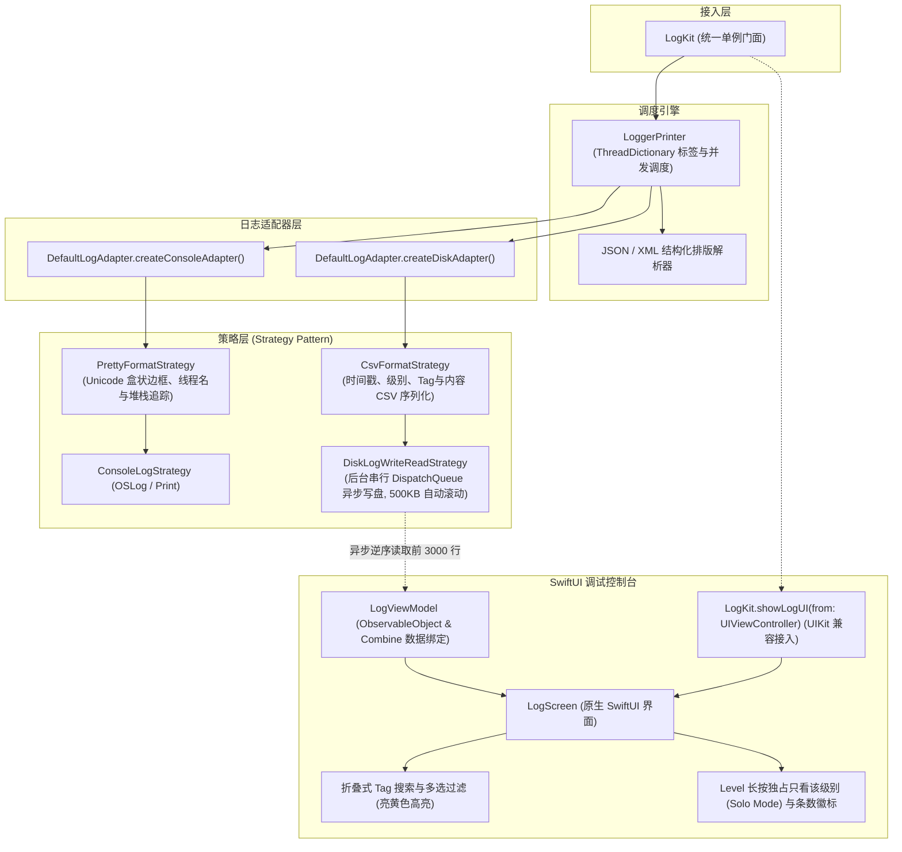

# LogKit (iOS / Swift)

<p align="center">
  <b>纯 Swift 打造、SwiftUI 原生驱动的 iOS 边端日志框架与应用内调试控制台</b>
</p>

<p align="center">
  
  
  
  
  <a href="https://github.com/e-hai/LogKit-Android"></a>
  <a href="LICENSE"></a>
</p>

> 💡 **跨平台版本**：LogKit 同时提供 100% 架构与交互对齐的 Android 原生版本 👉 [LogKit-Android (Kotlin / Jetpack Compose)](https://github.com/e-hai/LogKit-Android)。

---

## 📐 架构设计



---

## ✨ 核心特性

- 🚀 **100% 纯 Swift & SwiftUI 原生**：零第三方三方库依赖，支持 iOS 15.0+ 与 macOS 12.0+。
- 🔍 **可折叠内联 Tag 搜索与多选组合**：主界面一键折叠/展开搜索框，支持多 Tag 组合勾选过滤，匹配关键字自动应用**亮黄色高亮**（`#FFFFD54F`）。
- 🎯 **Level 级别长按独占模式（Solo Mode）**：长按 `E` 芯片一秒快速切换为“只看 Error”；各芯片实时显示命中日志条数。
- 🏷️ **活动标签吸顶栏**：已选 Tag 以带 `✕` 的独立胶囊展示，点击一秒移除单个标签，并支持一键清空全部已选标签。
- 📁 **异步串行队列磁盘持久化**：专属后台单串行 `DispatchQueue` 异步写盘，单文件达到 500KB 自动分卷滚动（`logs_*.csv`），控制台逆序高效读取最近 3000 行。
- ☀️/🌙 **明/暗双主题无缝切换**：一键切换暗黑极客模式 (`#121212`) 与清爽日间模式 (`#F5F5F5`)。
- 📋 **便捷复制**：点击任意日志卡片直接将格式化日志复制至系统剪贴板并弹出 Toast 提示。

---

## 🛠️ 第三方接入与依赖配置

### 方式 A：Swift Package Manager (SPM) (推荐)

#### 1. Xcode 图形化添加
1. 在 Xcode 中打开你的项目，依次点击菜单栏：`File` -> `Add Package Dependencies...`
2. 在搜索框输入仓库地址：
   ```
   https://github.com/e-hai/LogKit-iOS.git
   ```
3. 在 Dependency Rule 中选择 **Exact Version** 并填入 `1.0.0`（或选择分支 `main`），点击 **Add Package** 即可。

#### 2. 在 `Package.swift` 中声明依赖
```swift
dependencies: [
    .package(url: "https://github.com/e-hai/LogKit-iOS.git", exact: "1.0.0")
],
targets: [
    .target(
        name: "MyApp",
        dependencies: [
            .product(name: "LogKit", package: "LogKit-iOS")
        ]
    )
]
```

---

## 💡 快速上手使用

### 1. 初始化

#### SwiftUI App 入口 (`@main App`)
```swift
import SwiftUI
import LogKit

@main
struct MyApp: App {
    init() {
        // 推荐：全功能初始化 (控制台美化打印 + 本地磁盘持久化，支持应用内控制台)
        LogKit.initAllLog()

        // 或：仅初始化控制台打印 (不持久化到磁盘)
        // LogKit.initOnlyConsoleLog()
    }

    var body: some Scene {
        WindowGroup {
            ContentView()
        }
    }
}
```

#### UIKit `AppDelegate` 入口
```swift
import UIKit
import LogKit

@main
class AppDelegate: UIResponder, UIApplicationDelegate {
    func application(
        _ application: UIApplication,
        didFinishLaunchingWithOptions launchOptions: [UIApplication.LaunchOptionsKey: Any]?
    ) -> Bool {
        LogKit.initAllLog()
        return true
    }
}
```

### 2. 日志打印使用

```swift
import LogKit

// 1. 基础日志打印 (各级别)
LogKit.v("TAG", "详细跟踪日志")
LogKit.d("TAG", "调试信息")
LogKit.i("TAG", "普通提示信息")
LogKit.w("TAG", "警告信息")
LogKit.e("TAG", "错误信息")
LogKit.wtf("TAG", "断言严重错误")

// 2. 省略 Tag 打印 (默认 Tag 为 "LogKit")
LogKit.d("直接输出一条调试信息")

// 3. 链式设置单次临时 Tag (打印后自动清除，不污染线程)
LogKit.t("CUSTOM_TAG").d("使用临时 Tag 输出日志")

// 4. 异常与错误打印
let err = NSError(domain: "com.example.network", code: -1009, userInfo: [NSLocalizedDescriptionKey: "网络连接断开"])
LogKit.e("NETWORK", error: err, "执行接口调用发生异常")

// 5. 结构化 JSON 与 XML 自动美化排版
LogKit.json("{\"user\": \"iOS_Developer\", \"status\": \"success\", \"code\": 200}")
LogKit.xml("<config><theme>dark</theme><debug enabled=\"true\"/></config>")
```

### 3. 唤起应用内调试控制台

#### 方式 A：SwiftUI 嵌入 (推荐)
```swift
import SwiftUI
import LogKit

struct MySettingsView: View {
    @State private var showLogInspector = false

    var body: some View {
        Button("查看日志控制台") {
            showLogInspector = true
        }
        .sheet(isPresented: $showLogInspector) {
            LogScreen(onBackClick: {
                showLogInspector = false
            })
        }
    }
}
```

#### 方式 B：UIKit 调起 (全屏呈现)
```swift
LogKit.showLogUI(from: currentViewController)
```

---

## 📱 控制台高效交互技巧

1. **Tag 搜索与多选**：点击顶部右上角 `🔍` 展开内联搜索框，输入关键字实时模糊匹配 Tag，支持同时勾选多个关联模块（如 `NETWORK` + `AUTH` 并排查看）。
2. **长按独占级别（Solo Mode）**：长按级别芯片（如长按 `E`）一秒直达“只看 Error”模式；再次长按或点击 `ALL` 恢复全选。
3. **活动 Tag 快速移除**：选中的 Tag 会作为带 `✕` 的活动胶囊停靠在顶栏下方，点击单个 `✕` 即可将其从过滤集合中移除，点击 `清空` 一键还原全部日志。
4. **手动折叠控制栏**：点击右上角折叠箭头 `▲`，可收起整个控制栏进入 100% 全屏日志模式；收起后点击右上角浮动按钮随时唤回。
5. **点击卡片一键复制**：点击任意日志卡片，整条日志（含时间戳、级别、Tag 和正文）将自动复制到系统剪贴板。

---

## 🏃 运行 Demo 工程

在终端中执行以下命令直接在 Xcode 中打开自带的 Demo：
```bash
open LogKitDemo.xcodeproj
```
在 Xcode 顶部选择任意一台 **iOS 模拟器**（如 iPhone 16 Pro），按 **`⌘ + R`** 即可直接运行并体验与 Android 镜像对齐的完整 Demo 主页面。

---

## 📄 开源协议
Apache License 2.0
