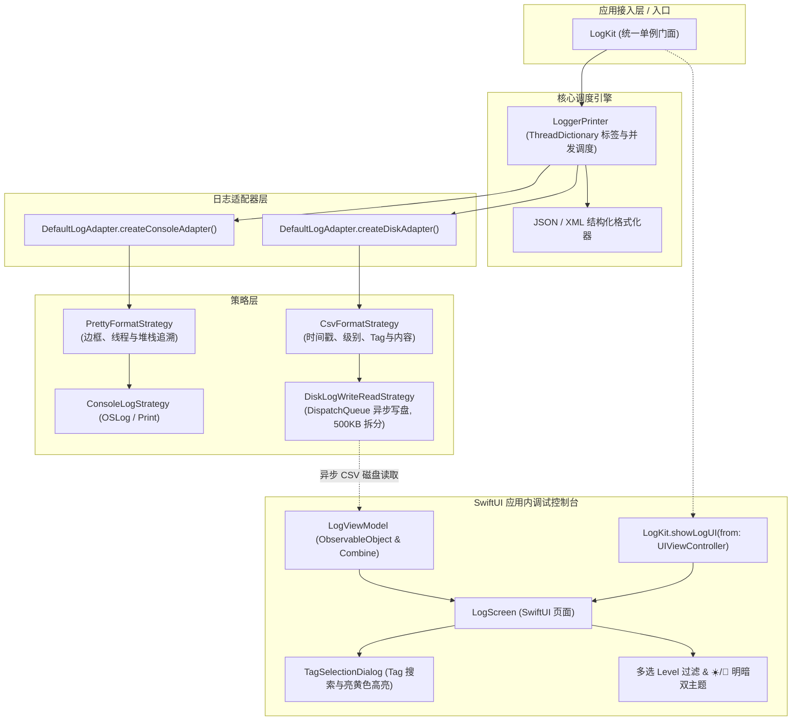

# LogKit (iOS / Swift)

<p align="center">
  <b>纯 Swift 打造、SwiftUI 原生驱动的 iOS 边端日志框架与应用内调试控制台</b>
</p>

<p align="center">
  
  
  
  
  <a href="https://github.com/e-hai/LogKit-Android"></a>
  <a href="LICENSE"></a>
</p>

> 💡 **跨平台支持**：如果你正在寻找 Android / Kotlin 版本的实现，请访问独立仓库 👉 [LogKit-Android (Kotlin / Jetpack Compose)](https://github.com/e-hai/LogKit-Android)。

---

## 📐 架构设计



---

## ✨ 核心特性

- 🚀 **100% 纯 Swift & SwiftUI 原生**：极简现代架构，采用 SwiftUI 原生打造高颜值端侧控制台，支持 iOS 15.0+ 与 macOS 12.0+。
- 📁 **异步串行队列磁盘持久化**：后台专属 `DispatchQueue` 异步写盘，完全不阻塞主线程，支持 500KB 日志文件自动拆分与最近 3000 条日志高效读取。
- 🎯 **直观的日志级别 (Priority) 多选过滤**：支持 `V`、`D`、`I`、`W`、`E` 独立代表色多选切换与一键 `ALL` 全选。
- 🔍 **Tag 网格检索与亮黄色匹配高亮**：内置专用的 Tag 搜索弹窗，搜索词子串自动应用亮黄色背景 (`#FFFFD54F`) 高亮。
- ☀️/🌙 **明/暗双主题一键无缝切换**：动态支持暗黑极客模式 (`#121212`) 与清爽日间模式 (`#F5F5F5`)。
- 📱 **滑动自动折叠 Header**：滑动浏览时控制栏自动收起以开启 100% 全屏 Log 区域，右上方悬浮迷你按钮支持一键唤回。
- 📦 **Swift Package Manager 原生支持**：无需任何第三方三方库依赖，零依赖开箱即用。

---

## 🛠 安装引入 (SPM)

在 Xcode 中依次点击 `File` -> `Add Package Dependencies...`，输入仓库地址并选择 `ios` 分支：

```
https://github.com/e-hai/LogKit.git
Branch: ios
```

或者在你的 `Package.swift` 中引入：

```swift
dependencies: [
    .package(url: "https://github.com/e-hai/LogKit.git", branch: "ios")
]
```

---

## 💡 使用指引

### 1. 初始化

在 `AppDelegate` 或 `@main App` 的 `init()` 中进行初始化：

```swift
import LogKit

// 初始化控制台输出与本地持久化（推荐）
LogKit.initAllLog()

// 或仅初始化控制台打印
LogKit.initOnlyConsoleLog()
```

### 2. 日志打印

```swift
// 基础打印
LogKit.d("这是一条调试日志")
LogKit.d("NETWORK", "网络请求成功: code=200")
LogKit.i("TAG", "普通提示日志")
LogKit.w("TAG", "警告日志")
LogKit.e("TAG", "错误日志")

// 链式指定临时 Tag（仅对当前单次打印生效）
LogKit.t("CUSTOM_TAG").d("带临时 Tag 的日志")

// JSON 与 XML 结构化排版
LogKit.json("{\"user\": \"SwiftDeveloper\", \"status\": \"active\"}")
LogKit.xml("<config><item name=\"debug\">true</item></config>")
```

### 3. 唤起应用内调试控制台

#### 方式 A：SwiftUI 嵌入
```swift
import SwiftUI
import LogKit

struct MyView: View {
    @State private var showLogs = false

    var body: some View {
        Button("查看日志控制台") {
            showLogs = true
        }
        .sheet(isPresented: $showLogs) {
            LogScreen(onBackClick: {
                showLogs = false
            })
        }
    }
}
```

#### 方式 B：UIKit 调起
```swift
LogKit.showLogUI(from: currentViewController)
```

---

## 📄 开源协议
Apache License 2.0
